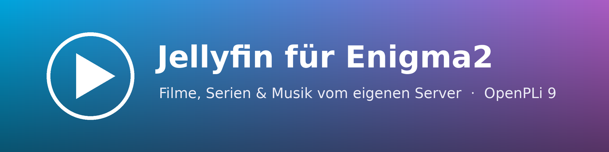
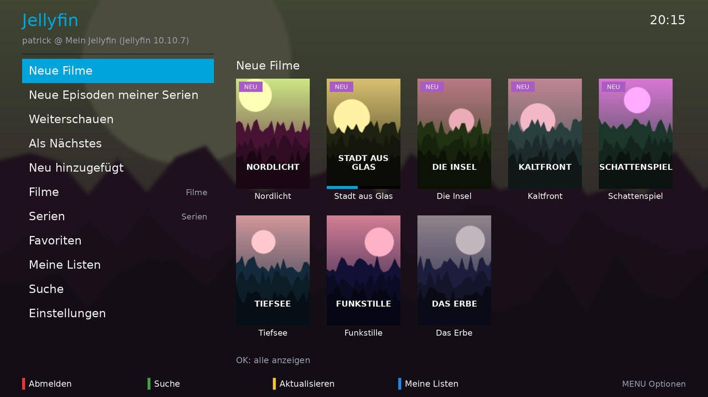
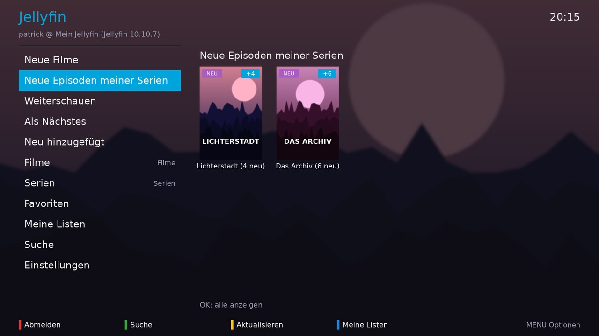
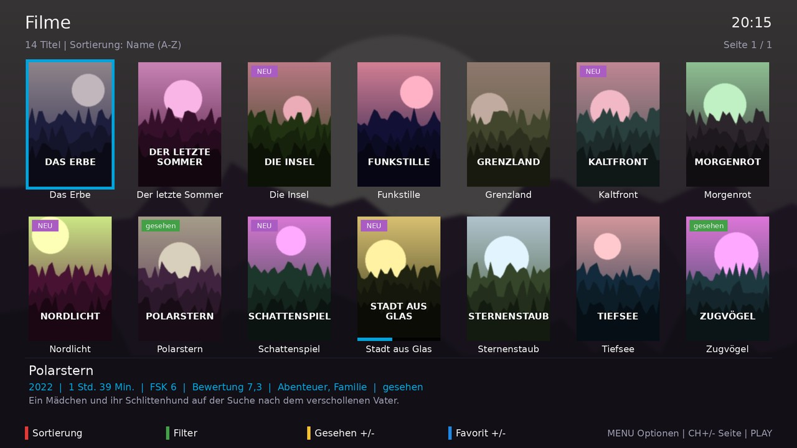
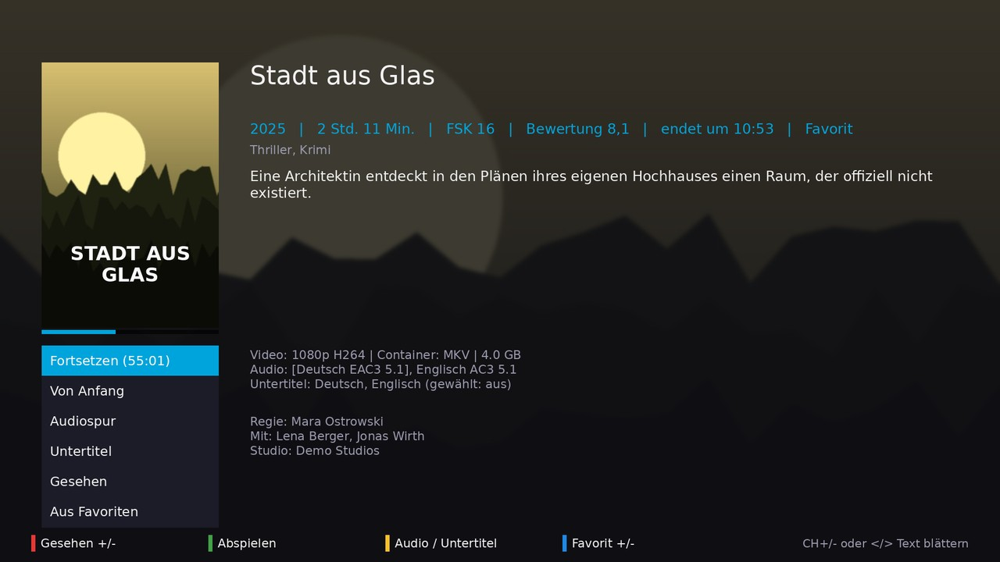
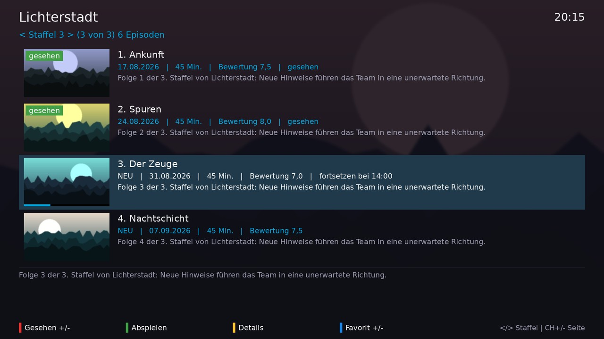
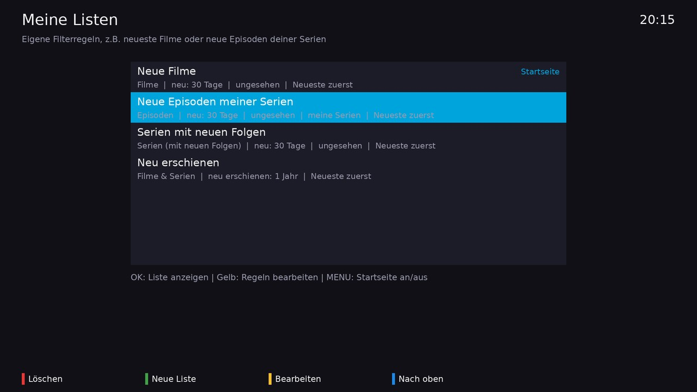
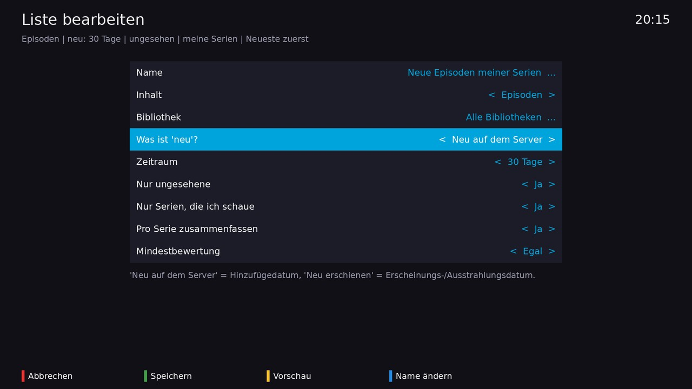
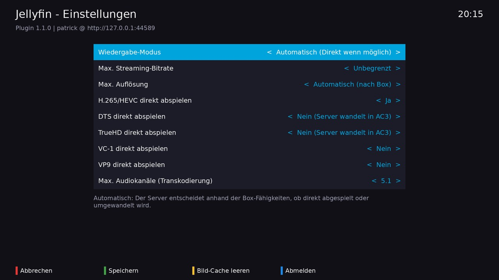

<p align="center">
  
</p>

<p align="center">
  <a href="README.md">🇩🇪 Deutsch</a> &nbsp;·&nbsp; <b>🇬🇧 English</b> &nbsp;·&nbsp; <a href="README.nl.md">🇳🇱 Nederlands</a>
</p>

<p align="center">
  <a href="https://github.com/xionix3/jellyfine2/actions/workflows/ci.yml"></a>
  <a href="https://github.com/xionix3/jellyfine2/releases/latest"></a>
  <a href="https://github.com/xionix3/jellyfine2/releases"></a>
  
  
  <a href="LICENSE"></a>
</p>

**Jellyfin for Enigma2** is an unofficial [Jellyfin](https://jellyfin.org) client for set-top boxes running **OpenPLi 9**. Watch movies, shows and music from your own Jellyfin server on your TV – with posters, resume, your own lists like "new movies" and automatic next episode. Designed on the **Octagon SF8008**, runs on every OpenPLi 9 box (pure Python, `Architecture: all`).

> The user interface is currently German.

---

## 📸 Screenshots

| | |
|:---:|:---:|
|  |  |
| **Start screen** – own lists on top, preview on the right | **New episodes of my shows** – one tile per show |
|  |  |
| **Poster grid** with NEW and watched badges | **Details** with resume, audio and subtitle tracks |
|  |  |
| **Seasons & episodes** with thumbnails | **My lists** – your own filter rules |
|  |  |
| **List editor** | **Settings** |

<sub>The screenshots show the real plugin screens with demo content (made-up titles, generated artwork). CI regenerates them on every run.</sub>

---

## ✨ Features

- **Login** with username/password or **Quick Connect** (no typing), automatic **server discovery** on the LAN
- **Start screen** with continue watching, next up, recently added, all libraries and favourites – every preview loads in parallel and stays cached
- **My lists**: your own filter rules, e.g. *new movies of the last 30 days* or *new episodes of the shows I watch*
- **Poster grid** with sorting, filters (unplayed, played, favourites, in progress, genre), NEW badge, progress bars and backdrop
- **Details** with resume, audio/subtitle selection, multiple versions, cast and similar titles
- **Seasons & episodes**, **music albums**, **search**
- **Playback** through the Enigma2 movie player (GStreamer or ServiceApp):
  direct play in original quality (4K/HEVC on UHD boxes) or transcoded by the server (HLS), e.g. for DTS audio or picture-based subtitles
- Progress and watched state are reported to the server, **next episode plays automatically**
- HD and Full-HD skins, connection reuse, prefetching, optional image cache on HDD/USB

## 📦 Installation

**Quick** – via telnet/SSH on the box:

```sh
wget -O /tmp/jellyfin.ipk https://github.com/xionix3/jellyfine2/releases/latest/download/enigma2-plugin-extensions-jellyfine2_all.ipk \
  && opkg install /tmp/jellyfin.ipk && init 4 && sleep 2 && init 3
```

**Manual:** download the `.ipk` from the [latest release](https://github.com/xionix3/jellyfine2/releases/latest), copy it to `/tmp` on the box (FTP) and install:

```sh
opkg install /tmp/enigma2-plugin-extensions-jellyfine2_*_all.ipk
init 4 && sleep 2 && init 3      # restart the GUI
```

**Update:** same way – the new version installs over the old one, settings and lists are kept.
**Remove:** `opkg remove enigma2-plugin-extensions-jellyfine2`

## 🚀 Getting started

1. Open *Main menu → Jellyfin*.
2. Enter the **server**, e.g. `http://192.168.1.10:8096` – or press **blue** to discover it on your network.
3. Enter **user** and **password** and log in with **green** – or press **yellow** for Quick Connect and confirm the code in the Jellyfin app under *User → Quick Connect*.

The login is remembered. Log out with **red** on the start screen.

## 🎮 Remote control

| Screen | Keys |
|---|---|
| **Start screen** | ▲▼ section · OK open · 🟢 search · 🟡 refresh · 🔵 my lists · MENU settings & more · 🔴 log out |
| **Poster grid** | arrows · CH+/- page · OK open · PLAY play · 🔴 sort · 🟢 filter/genre · 🟡 watched ± · 🔵 favourite ± · INFO details |
| **Details** | ▲▼ action · ◀▶ / CH± scroll text · 🟢 play · 🟡 audio/subtitles · 🔴 watched ± · 🔵 favourite ± |
| **Episodes** | ▲▼ episode · ◀▶ season · OK play · 🟡 details · MENU mark whole season watched |
| **My lists** | OK show list · 🟢 new · 🟡 edit · 🔴 delete · 🔵 move up · MENU start screen on/off, duplicate |
| **Player** | ◀ −10 s · ▶ +30 s · ▲▼ info bar · ⏮ ⏭ previous/next episode · INFO info · STOP/EXIT quit · AUDIO/SUBTITLE as usual |

## 🗂️ My lists

Own lists appear as sections at the top of the start screen. Per list you can set:

| Setting | Options |
|---|---|
| Content | movies · shows with new episodes · episodes · movies & shows |
| Library | all or a specific one |
| What is "new"? | *new on the server* (date added) or *newly released* (premiere) |
| Time window | 3 days to 2 years, or unlimited |
| Filters | unplayed only · only shows I watch · minimum rating · genre |
| Display | group per show · sort order · max. items · on the start screen yes/no |

**New movies** and **New episodes of my shows** are preset. **Shows with new episodes** and **Newly released** can be enabled in *My lists*.

## ⚙️ Settings

| Setting | Meaning |
|---|---|
| Playback mode | automatic (server decides) · always direct · always transcode |
| Max. bitrate / resolution | for remote access or HD boxes; *automatic* detects UHD boxes |
| HEVC / DTS / TrueHD / VC-1 / VP9 | what the box may play directly (DTS/TrueHD default → AC3) |
| Player | GStreamer (4097) or – if installed – ServiceApp exteplayer3/gstplayer |
| Autoplay next episode, resume | behaviour for shows and saved positions |
| NEW badge, backdrops | look |
| Own lists on the start screen | top · after "continue watching" · bottom |
| Image cache | RAM (fast) or HDD/USB (survives a reboot) |
| Verify SSL certificate | turn off for servers with a self-signed certificate |

## ❓ FAQ

<details>
<summary><b>No sound on some movies</b></summary>

The audio track is probably DTS or TrueHD. Make sure *play DTS/TrueHD directly* is set to **no** – the server then converts the audio to AC3.
</details>

<details>
<summary><b>"The server cannot prepare this item for the box"</b></summary>

Transcoding is disabled for your Jellyfin user. Enable "Allow video playback that requires transcoding" in the Jellyfin dashboard under *Users → Playback*.
</details>

<details>
<summary><b>Stuttering over the internet</b></summary>

Set *max. streaming bitrate* to e.g. 8 or 10 Mbit/s – the server then scales large files down.
</details>

<details>
<summary><b>SSL error with https</b></summary>

For self-signed certificates set *verify SSL certificate* to **no**.
</details>

<details>
<summary><b>Reporting bugs</b></summary>

Please open an [issue](https://github.com/xionix3/jellyfine2/issues/new/choose) and attach the lines containing `[Jellyfin]` from the Enigma2 debug log (*Menu → Setup → System → Logs*), plus your box, image version and Jellyfin version.
</details>

## 🧩 Compatibility

- **Images:** OpenPLi 9.0 – 9.2 (Python 3). Other Python 3 images based on OpenPLi usually work as well.
- **Boxes:** every OpenPLi 9 receiver; 4K/HEVC direct play on UHD boxes such as SF8008, HD51, Vu+ 4K, Dreambox DM900/DM920 …
- **Jellyfin:** 10.8 to 10.11 (the API routes changed in 10.9 are detected automatically)
- **Skins:** HD (1280×720) and Full HD (1920×1080), own layout independent of the box skin
- Not included: Live TV/DVR, photos, books

<a id="development"></a>

## 🛠️ Development

Everything runs off-box: a fake Jellyfin server (`tests/mockjf.py`) and stubs of the Enigma2 Python API (`tests/e2stubs/`) run the real screens headless. The stubs validate skins against the screen components (a missing component is a `SkinError` on a real box), check every key action against the real OpenPLi `keymap.xml`, and catch attributes that would shadow the `Screen` dict API.

```sh
pip install -r requirements-dev.txt
make lint test ipk      # the .ipk ends up in dist/
make screenshots        # regenerates docs/screenshots/
```

CI (GitHub Actions) runs lint and a Python 3.6 syntax check, the test matrix (Python 3.9–3.13 × OpenPLi 9.0/9.2 keymaps × Jellyfin 10.8/10.10/10.11 × HD/FHD), builds the `.ipk` and renders the screenshots.

**Releasing:** bump `CLIENT_VERSION` in `src/JellyfinE2/jfapi.py`, add a `CHANGELOG.md` entry, then publish a GitHub release named `vX.Y.Z` – CI builds the package and attaches it (plus a stable-named copy for the one-line install). Pushing the tag `vX.Y.Z` works as well.

```
src/JellyfinE2/      plugin (installed to /usr/lib/enigma2/python/Plugins/Extensions/JellyfinE2)
  jfapi.py           Jellyfin REST client (pure python, keep-alive)
  jfrules.py         "my lists" rule engine (pure python)
  jfhome / jfgrid / jfdetail / jfepisodes / jfplayer / jflogin / jfsettings / jfrulesui   screens
  jfskin.py          embedded skins, designed for 1920x1080 and scaled at runtime
tests/               fake server, demo data, Enigma2 stubs, end-to-end tests, screenshot renderer
scripts/             ipk builder, syntax check, icon and banner generators
```

Contributions are welcome – issues and pull requests in English or German.

## 📄 License

[GPL-2.0-or-later](LICENSE). This project is not affiliated with the Jellyfin project or OpenPLi. Please use it with your own Jellyfin server and media you have the rights to.
