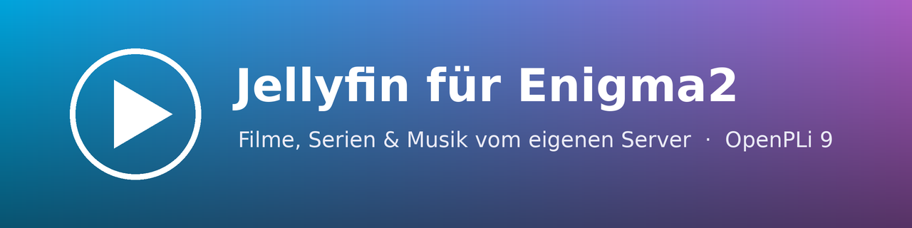
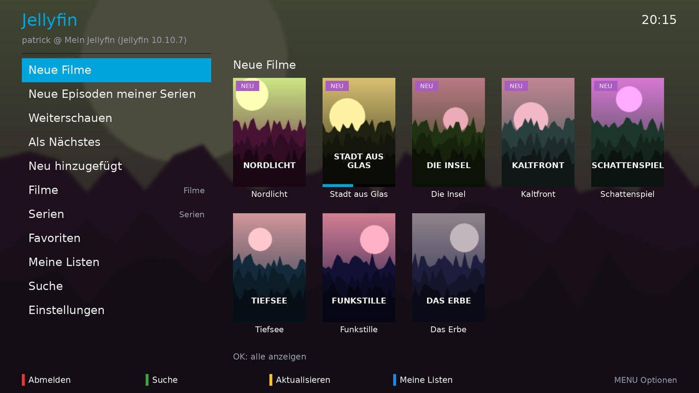
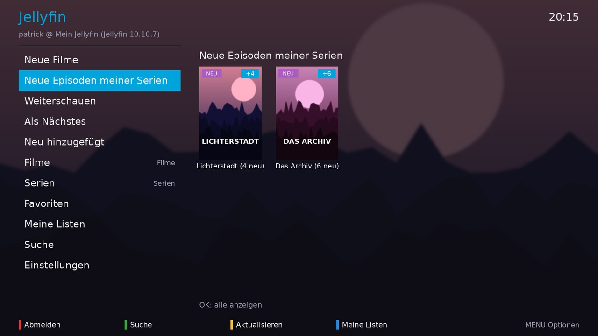
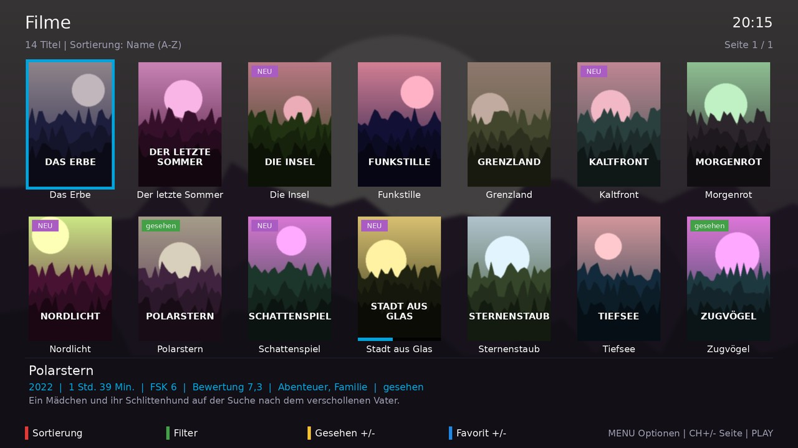
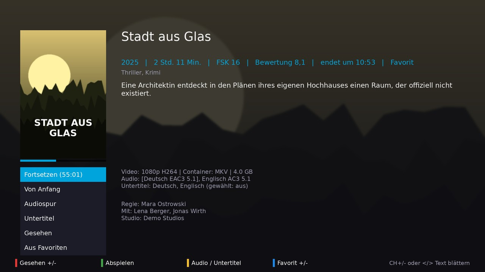
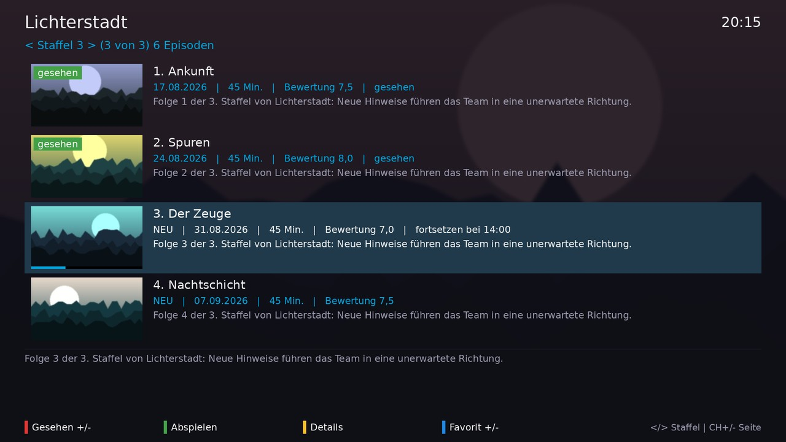
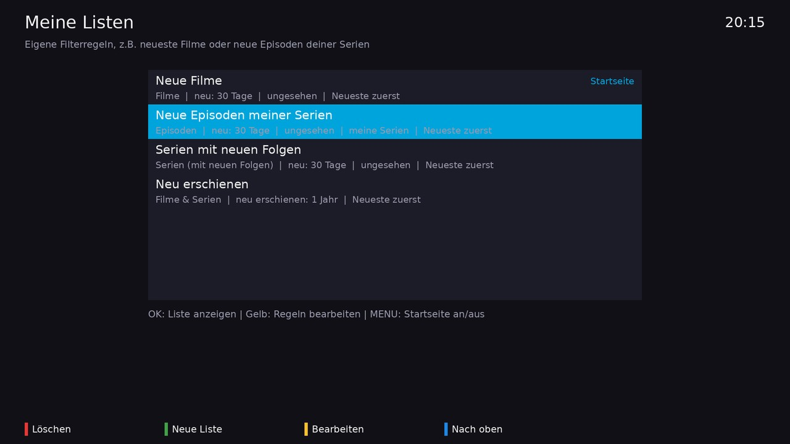
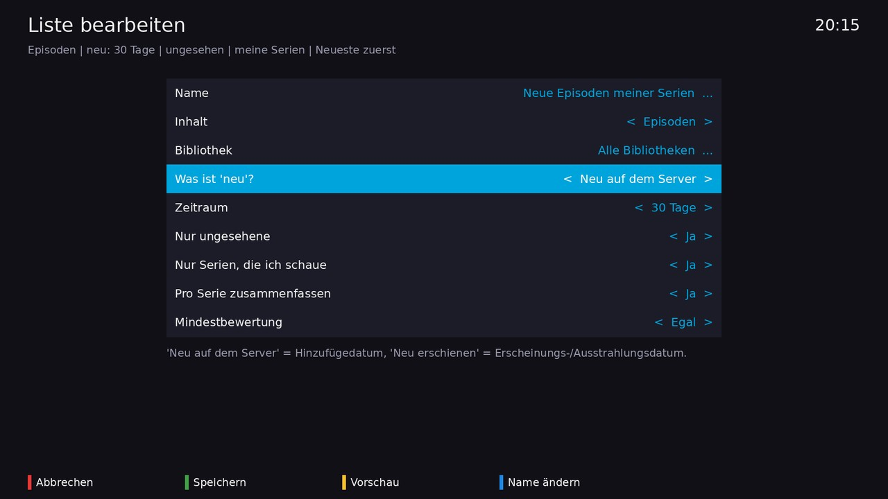
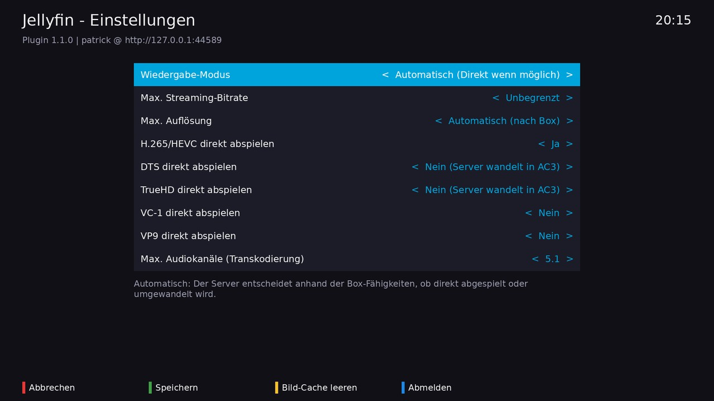

<p align="center">
  
</p>

<p align="center">
  <b>🇩🇪 Deutsch</b> &nbsp;·&nbsp; <a href="README.en.md">🇬🇧 English</a> &nbsp;·&nbsp; <a href="README.nl.md">🇳🇱 Nederlands</a>
</p>

<p align="center">
  <a href="https://github.com/xionix3/jellyfine2/actions/workflows/ci.yml"></a>
  <a href="https://github.com/xionix3/jellyfine2/releases/latest"></a>
  <a href="https://github.com/xionix3/jellyfine2/releases"></a>
  
  
  <a href="LICENSE"></a>
</p>

**Jellyfin für Enigma2** ist ein inoffizieller [Jellyfin](https://jellyfin.org)-Client für Receiver mit **OpenPLi 9**. Du siehst Filme, Serien und Musik von deinem eigenen Jellyfin-Server direkt am Fernseher – mit Postern, Fortsetzen-Funktion, eigenen Listen wie „Neue Filme“ und automatischer nächster Episode. Entwickelt und gestaltet auf der **Octagon SF8008**, läuft aber auf jeder OpenPLi-9-Box (reines Python, `Architecture: all`).

---

## 📸 Screenshots

| | |
|:---:|:---:|
|  |  |
| **Startseite** – eigene Listen oben, Vorschau rechts | **Neue Episoden meiner Serien** – eine Kachel pro Serie |
|  |  |
| **Poster-Raster** mit NEU- und Gesehen-Schildern | **Details** mit Fortsetzen, Audiospur und Untertiteln |
|  |  |
| **Staffeln & Episoden** mit Vorschaubildern | **Meine Listen** – eigene Filterregeln |
|  |  |
| **Listen-Editor** | **Einstellungen** |

<sub>Die Screenshots zeigen die echten Plugin-Bildschirme mit Demo-Inhalten (erfundene Titel, generierte Bilder). Sie werden bei jedem CI-Lauf neu erzeugt.</sub>

---

## ✨ Funktionen

- **Anmeldung** mit Benutzer/Passwort oder **Quick Connect** (ohne Tippen), automatische **Serversuche** im Heimnetz
- **Startseite** mit Weiterschauen, Als Nächstes, Neu hinzugefügt, allen Bibliotheken und Favoriten – alle Vorschauen laden parallel und bleiben zwischengespeichert
- **Meine Listen**: eigene Filterregeln, z. B. *Neue Filme der letzten 30 Tage* oder *Neue Episoden meiner Serien*
- **Poster-Raster** mit Sortierung, Filtern (ungesehen, gesehen, Favoriten, begonnen, Genre), NEU-Schild, Fortschrittsbalken und Hintergrundbild
- **Details** mit Fortsetzen, Audiospur- und Untertitelauswahl, mehreren Versionen, Besetzung und ähnlichen Titeln
- **Staffeln & Episoden**, **Musikalben**, **Suche**
- **Wiedergabe** über den Enigma2-Movieplayer (GStreamer oder ServiceApp):
  direkt in Originalqualität (auf UHD-Boxen auch 4K/HEVC) oder vom Server umgewandelt (HLS), z. B. bei DTS-Ton oder Bild-Untertiteln
- Fortschritt und Gesehen-Status werden an den Server gemeldet, **nächste Episode startet automatisch**
- HD- und Full-HD-Skins, wiederverwendete Verbindungen, Vorladen, Bild-Cache optional auf HDD/USB

## 📦 Installation

**Schnell** – per Telnet/SSH auf der Box:

```sh
wget -O /tmp/jellyfin.ipk https://github.com/xionix3/jellyfine2/releases/latest/download/enigma2-plugin-extensions-jellyfine2_all.ipk \
  && opkg install /tmp/jellyfin.ipk && init 4 && sleep 2 && init 3
```

**Manuell:** Die `.ipk` aus dem [neuesten Release](https://github.com/xionix3/jellyfine2/releases/latest) herunterladen, per FTP nach `/tmp` auf die Box kopieren und installieren:

```sh
opkg install /tmp/enigma2-plugin-extensions-jellyfine2_*_all.ipk
init 4 && sleep 2 && init 3      # GUI neu starten
```

**Update:** genauso – die neue Version installiert sich über die alte, Einstellungen und Listen bleiben erhalten.
**Entfernen:** `opkg remove enigma2-plugin-extensions-jellyfine2`

## 🚀 Erste Schritte

1. *Hauptmenü → Jellyfin* öffnen.
2. **Server** eintragen, z. B. `http://192.168.1.10:8096` – oder mit **Blau** den Server im Netzwerk suchen.
3. **Benutzer** und **Passwort** eingeben und mit **Grün** anmelden – oder **Gelb** für Quick Connect: Den angezeigten Code in der Jellyfin-App unter *Benutzer → Quick Connect* bestätigen.

Die Anmeldung bleibt gespeichert. Abmelden mit **Rot** auf der Startseite.

## 🎮 Bedienung

| Bildschirm | Tasten |
|---|---|
| **Startseite** | ▲▼ Bereich wählen · OK öffnen · 🟢 Suche · 🟡 aktualisieren · 🔵 Meine Listen · MENU Einstellungen & mehr · 🔴 abmelden |
| **Poster-Raster** | Pfeiltasten · CH+/- Seite · OK öffnen · PLAY abspielen · 🔴 Sortierung · 🟢 Filter/Genre · 🟡 gesehen ± · 🔵 Favorit ± · INFO Details |
| **Details** | ▲▼ Aktion · ◀▶ / CH± Text blättern · 🟢 abspielen · 🟡 Audio/Untertitel · 🔴 gesehen ± · 🔵 Favorit ± |
| **Episoden** | ▲▼ Episode · ◀▶ Staffel · OK abspielen · 🟡 Details · MENU ganze Staffel als gesehen markieren |
| **Meine Listen** | OK Liste anzeigen · 🟢 neu · 🟡 bearbeiten · 🔴 löschen · 🔵 nach oben · MENU Startseite an/aus, duplizieren |
| **Player** | ◀ −10 s · ▶ +30 s · ▲▼ Infoleiste · ⏮ ⏭ vorige/nächste Episode · INFO Infos · STOP/EXIT beenden · AUDIO/SUBTITLE wie gewohnt |

## 🗂️ Meine Listen

Eigene Listen erscheinen als Bereiche ganz oben auf der Startseite. Pro Liste einstellbar:

| Einstellung | Möglichkeiten |
|---|---|
| Inhalt | Filme · Serien mit neuen Folgen · Episoden · Filme & Serien |
| Bibliothek | alle oder eine bestimmte |
| Was ist „neu“? | *neu auf dem Server* (Hinzufügedatum) oder *neu erschienen* (Premiere) |
| Zeitraum | 3 Tage bis 2 Jahre oder unbegrenzt |
| Filter | nur ungesehene · nur Serien, die ich schaue · Mindestbewertung · Genre |
| Darstellung | pro Serie zusammenfassen · Sortierung · max. Einträge · auf der Startseite ja/nein |

Vorbelegt sind **Neue Filme** und **Neue Episoden meiner Serien**. **Serien mit neuen Folgen** und **Neu erschienen** lassen sich in *Meine Listen* einblenden.

## ⚙️ Einstellungen

| Einstellung | Bedeutung |
|---|---|
| Wiedergabe-Modus | Automatisch (Server entscheidet) · immer direkt · immer umwandeln |
| Max. Bitrate / Auflösung | für Fernzugriff oder HD-Boxen; *Automatisch* erkennt UHD-Boxen |
| HEVC / DTS / TrueHD / VC-1 / VP9 | was die Box direkt abspielen darf (DTS/TrueHD standardmäßig → AC3) |
| Player | GStreamer (4097) oder – falls installiert – ServiceApp exteplayer3/gstplayer |
| Nächste Episode automatisch, Fortsetzen | Verhalten bei Serien und gespeicherter Position |
| NEU-Markierung, Hintergrundbilder | Aussehen |
| Eigene Listen auf der Startseite | ganz oben · nach „Weiterschauen“ · unten |
| Bild-Cache | RAM (schnell) oder HDD/USB (bleibt nach Neustart erhalten) |
| SSL-Zertifikat prüfen | für Server mit selbstsigniertem Zertifikat abschalten |

## ❓ Häufige Fragen

<details>
<summary><b>Kein Ton bei manchen Filmen</b></summary>

Die Tonspur ist vermutlich DTS oder TrueHD. Stelle in den Einstellungen sicher, dass *DTS/TrueHD direkt abspielen* auf **Nein** steht – dann wandelt der Server den Ton in AC3 um.
</details>

<details>
<summary><b>„Der Server kann dieses Element nicht für die Box aufbereiten“</b></summary>

Für deinen Jellyfin-Benutzer ist das Umwandeln (Transkodierung) deaktiviert. Aktiviere im Jellyfin-Dashboard unter *Benutzer → Wiedergabe* „Transkodierung erlauben“.
</details>

<details>
<summary><b>Ruckeln über das Internet</b></summary>

*Max. Streaming-Bitrate* z. B. auf 8 oder 10 Mbit/s stellen – der Server rechnet große Dateien dann herunter.
</details>

<details>
<summary><b>SSL-Fehler bei https</b></summary>

Bei selbstsignierten Zertifikaten *SSL-Zertifikat prüfen* auf **Nein** stellen.
</details>

<details>
<summary><b>Fehler melden</b></summary>

Bitte ein [Issue](https://github.com/xionix3/jellyfine2/issues/new/choose) anlegen und die Zeilen mit `[Jellyfin]` aus dem Enigma2-Debug-Log anhängen (*Menü → Einstellungen → System → Logs*), dazu Box, Image-Version und Jellyfin-Version.
</details>

## 🧩 Kompatibilität

- **Images:** OpenPLi 9.0 – 9.2 (Python 3). Andere Python-3-Images mit OpenPLi-Basis funktionieren meist ebenfalls.
- **Boxen:** alle OpenPLi-9-Receiver; 4K/HEVC direkt auf UHD-Boxen wie SF8008, HD51, Vu+ 4K, Dreambox DM900/DM920 …
- **Jellyfin:** 10.8 bis 10.11 (die in 10.9 geänderten API-Routen werden automatisch erkannt)
- **Skins:** HD (1280×720) und Full HD (1920×1080), eigenständiges Layout unabhängig vom Box-Skin
- Nicht enthalten: Live-TV/DVR, Fotos, Bücher

## 🛠️ Entwicklung

Alles läuft ohne Box: ein nachgebauter Jellyfin-Server und Nachbildungen der Enigma2-Python-API führen die echten Bildschirme aus. Dabei werden Skins gegen die Bildschirm-Komponenten geprüft, alle Tasten gegen die echte OpenPLi-`keymap.xml` und typische Box-Abstürze erkannt.

```sh
pip install -r requirements-dev.txt
make lint test ipk      # .ipk liegt danach in dist/
make screenshots        # erzeugt docs/screenshots/ neu
```

Die CI (GitHub Actions) prüft Lint und Python-3.6-Syntax, testet in einer Matrix (Python 3.9–3.13 × OpenPLi 9.0/9.2 × Jellyfin 10.8/10.10/10.11 × HD/FHD), baut die `.ipk` und erzeugt die Screenshots. Ein veröffentlichtes Release `vX.Y.Z` bekommt die `.ipk` automatisch angehängt. Details zum Aufbau stehen in der [englischen Version](README.en.md#development).

Beiträge sind willkommen – Issues und Pull Requests gerne auf Deutsch oder Englisch.

## 📄 Lizenz

[GPL-2.0-or-later](LICENSE). Dieses Projekt ist nicht mit dem Jellyfin-Projekt oder OpenPLi verbunden. Bitte nur mit deinem eigenen Jellyfin-Server und Medien nutzen, an denen du die Rechte hast.
