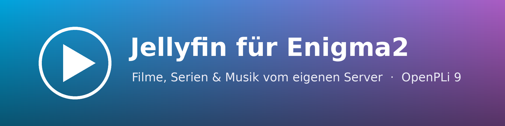
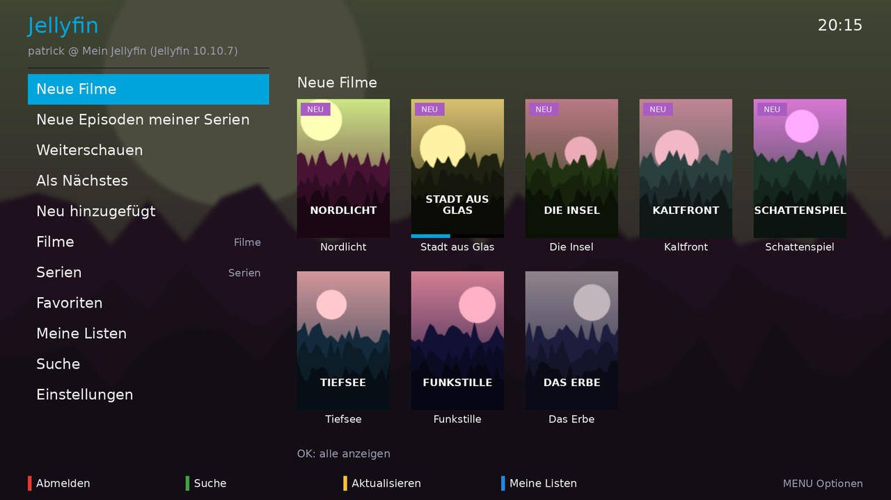
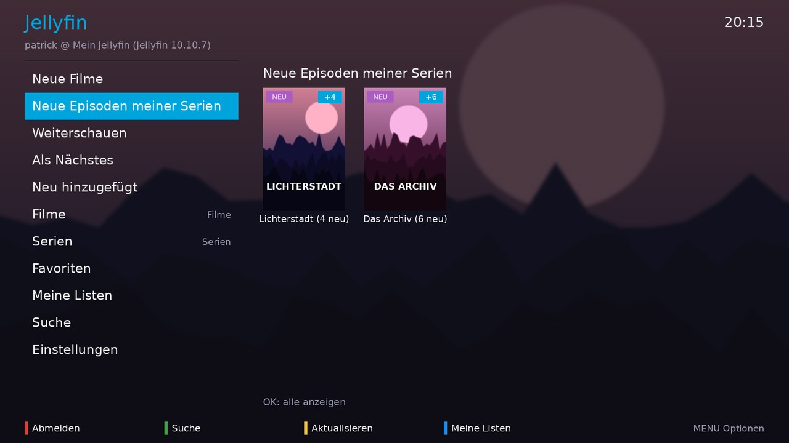
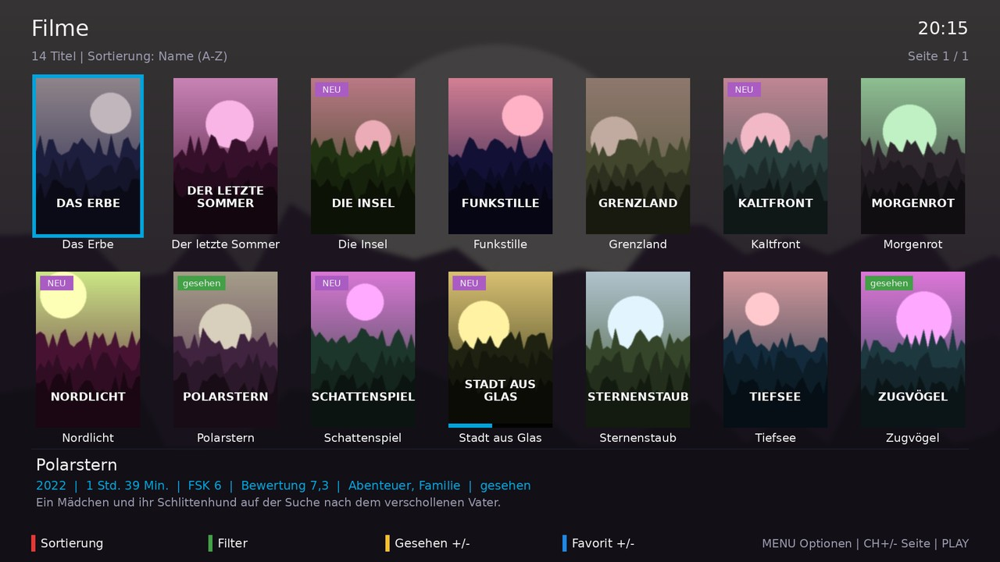
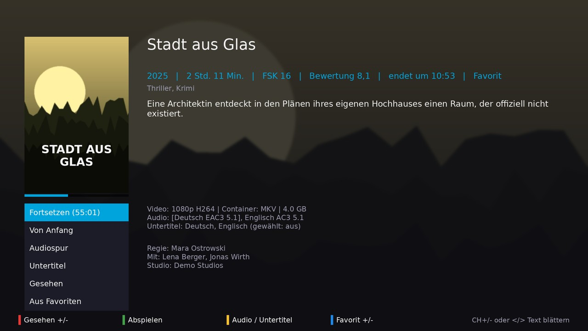
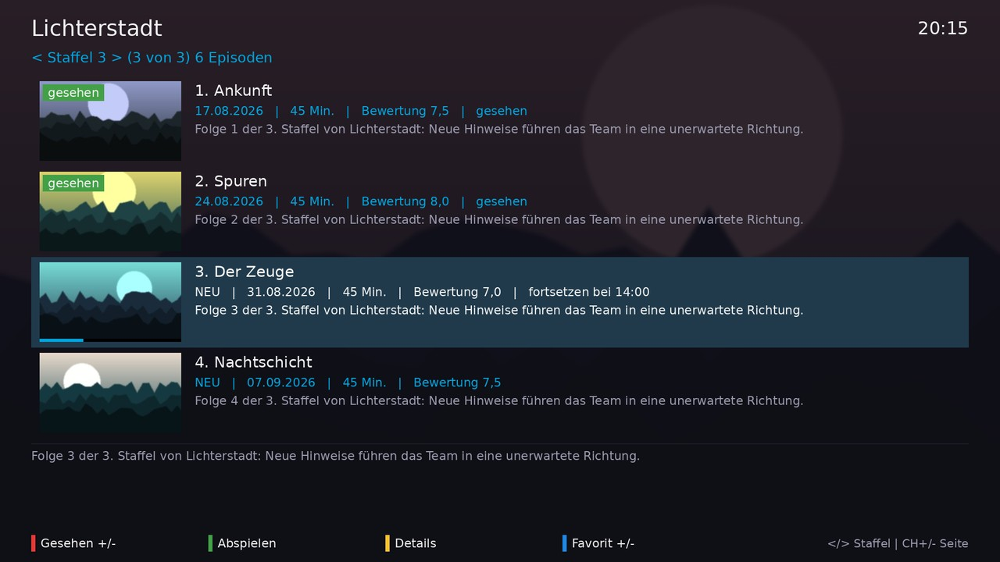
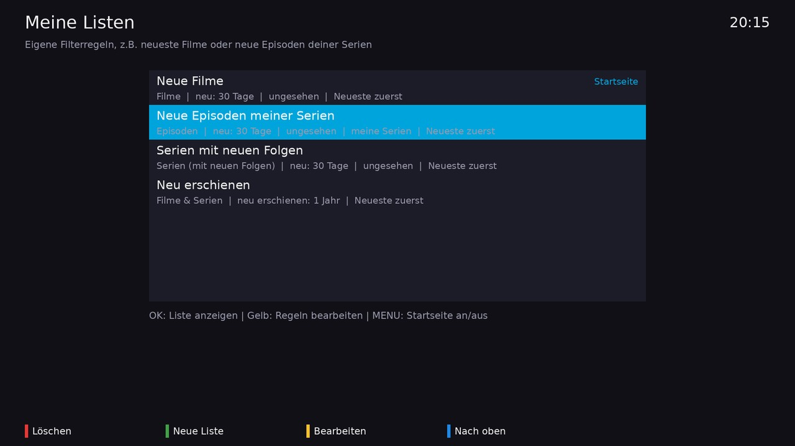
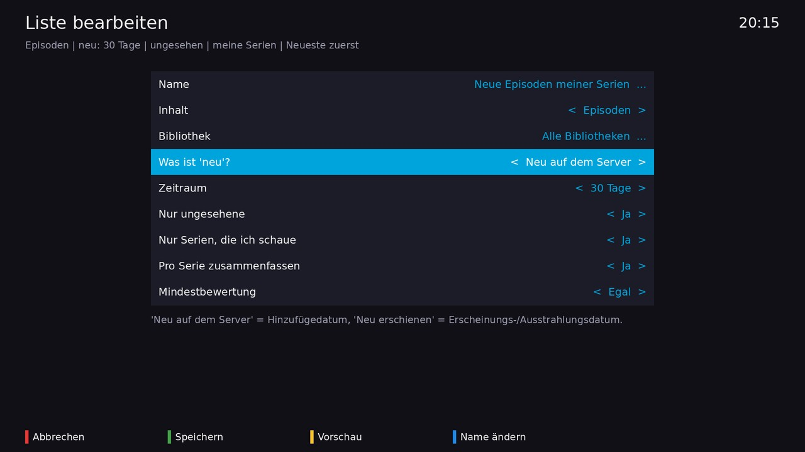
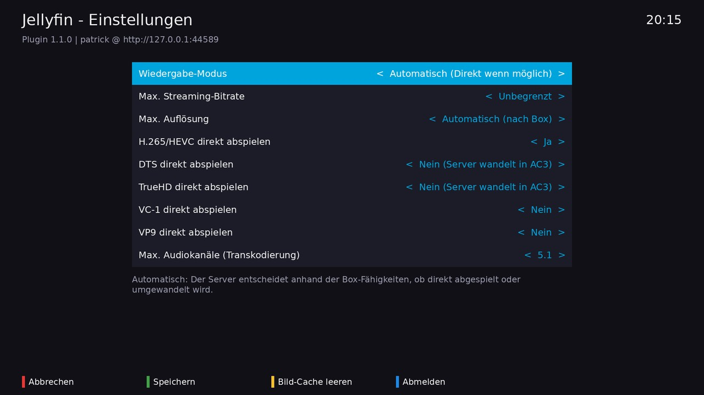

<p align="center">
  
</p>

<p align="center">
  <a href="README.md">🇩🇪 Deutsch</a> &nbsp;·&nbsp; <a href="README.en.md">🇬🇧 English</a> &nbsp;·&nbsp; <b>🇳🇱 Nederlands</b>
</p>

<p align="center">
  <a href="https://github.com/xionix3/jellyfine2/actions/workflows/ci.yml"></a>
  <a href="https://github.com/xionix3/jellyfine2/releases/latest"></a>
  <a href="https://github.com/xionix3/jellyfine2/releases"></a>
  
  
  <a href="LICENSE"></a>
</p>

**Jellyfin voor Enigma2** is een onofficiële [Jellyfin](https://jellyfin.org)-client voor ontvangers met **OpenPLi 9**. Bekijk films, series en muziek van je eigen Jellyfin-server rechtstreeks op je tv – met posters, verder kijken, eigen lijsten zoals "nieuwe films" en automatisch de volgende aflevering. Ontworpen op de **Octagon SF8008**, werkt op elke OpenPLi 9-box (puur Python, `Architecture: all`).

> De gebruikersinterface is op dit moment Duitstalig.

---

## 📸 Screenshots

| | |
|:---:|:---:|
|  |  |
| **Startscherm** – eigen lijsten bovenaan, voorbeeld rechts | **Nieuwe afleveringen van mijn series** – één tegel per serie |
|  |  |
| **Posteroverzicht** met NIEUW- en bekeken-labels | **Details** met verder kijken, audio- en ondertitelsporen |
|  |  |
| **Seizoenen & afleveringen** met voorbeeldbeelden | **Mijn lijsten** – eigen filterregels |
|  |  |
| **Lijsteditor** | **Instellingen** |

<sub>De screenshots tonen de echte schermen van de plugin met demo-inhoud (verzonnen titels, gegenereerde afbeeldingen). De CI maakt ze bij elke run opnieuw.</sub>

---

## ✨ Functies

- **Inloggen** met gebruikersnaam/wachtwoord of **Quick Connect** (zonder typen), automatisch **server zoeken** in het thuisnetwerk
- **Startscherm** met verder kijken, volgende, onlangs toegevoegd, alle bibliotheken en favorieten – alle voorbeelden laden tegelijk en blijven in de cache
- **Mijn lijsten**: eigen filterregels, bv. *nieuwe films van de laatste 30 dagen* of *nieuwe afleveringen van de series die ik kijk*
- **Posteroverzicht** met sorteren, filters (niet bekeken, bekeken, favorieten, begonnen, genre), NIEUW-label, voortgangsbalken en achtergrondafbeelding
- **Details** met verder kijken, keuze van audio en ondertitels, meerdere versies, cast en vergelijkbare titels
- **Seizoenen & afleveringen**, **muziekalbums**, **zoeken**
- **Afspelen** via de Enigma2-moviespeler (GStreamer of ServiceApp):
  direct in originele kwaliteit (4K/HEVC op UHD-boxen) of omgezet door de server (HLS), bv. bij DTS-geluid of beeldondertitels
- Voortgang en bekeken-status worden aan de server gemeld, **de volgende aflevering start automatisch**
- HD- en Full-HD-skins, hergebruik van verbindingen, vooraf laden, afbeeldingscache optioneel op HDD/USB

## 📦 Installatie

**Snel** – via telnet/SSH op de box:

```sh
wget -O /tmp/jellyfin.ipk https://github.com/xionix3/jellyfine2/releases/latest/download/enigma2-plugin-extensions-jellyfine2_all.ipk \
  && opkg install /tmp/jellyfin.ipk && init 4 && sleep 2 && init 3
```

**Handmatig:** download de `.ipk` uit de [nieuwste release](https://github.com/xionix3/jellyfine2/releases/latest), kopieer hem via FTP naar `/tmp` op de box en installeer:

```sh
opkg install /tmp/enigma2-plugin-extensions-jellyfine2_*_all.ipk
init 4 && sleep 2 && init 3      # GUI herstarten
```

**Bijwerken:** op dezelfde manier – de nieuwe versie wordt over de oude geïnstalleerd, instellingen en lijsten blijven behouden.
**Verwijderen:** `opkg remove enigma2-plugin-extensions-jellyfine2`

## 🚀 Aan de slag

1. Open *Hoofdmenu → Jellyfin*.
2. Vul de **server** in, bv. `http://192.168.1.10:8096` – of druk op **blauw** om hem in het netwerk te zoeken.
3. Vul **gebruiker** en **wachtwoord** in en log in met **groen** – of druk op **geel** voor Quick Connect en bevestig de code in de Jellyfin-app onder *Gebruiker → Quick Connect*.

De aanmelding wordt onthouden. Afmelden met **rood** op het startscherm.

## 🎮 Bediening

| Scherm | Toetsen |
|---|---|
| **Startscherm** | ▲▼ onderdeel kiezen · OK openen · 🟢 zoeken · 🟡 vernieuwen · 🔵 mijn lijsten · MENU instellingen & meer · 🔴 afmelden |
| **Posteroverzicht** | pijltjes · CH+/- pagina · OK openen · PLAY afspelen · 🔴 sorteren · 🟢 filter/genre · 🟡 bekeken ± · 🔵 favoriet ± · INFO details |
| **Details** | ▲▼ actie · ◀▶ / CH± tekst bladeren · 🟢 afspelen · 🟡 audio/ondertitels · 🔴 bekeken ± · 🔵 favoriet ± |
| **Afleveringen** | ▲▼ aflevering · ◀▶ seizoen · OK afspelen · 🟡 details · MENU heel seizoen als bekeken markeren |
| **Mijn lijsten** | OK lijst tonen · 🟢 nieuw · 🟡 bewerken · 🔴 verwijderen · 🔵 omhoog · MENU startscherm aan/uit, dupliceren |
| **Speler** | ◀ −10 s · ▶ +30 s · ▲▼ infobalk · ⏮ ⏭ vorige/volgende aflevering · INFO info · STOP/EXIT stoppen · AUDIO/SUBTITLE zoals gewoonlijk |

## 🗂️ Mijn lijsten

Eigen lijsten verschijnen als onderdelen bovenaan het startscherm. Per lijst in te stellen:

| Instelling | Mogelijkheden |
|---|---|
| Inhoud | films · series met nieuwe afleveringen · afleveringen · films & series |
| Bibliotheek | alle of een bepaalde |
| Wat is "nieuw"? | *nieuw op de server* (datum toegevoegd) of *nieuw verschenen* (première) |
| Periode | 3 dagen tot 2 jaar, of onbeperkt |
| Filters | alleen niet bekeken · alleen series die ik kijk · minimale beoordeling · genre |
| Weergave | per serie samenvoegen · sortering · max. aantal · op het startscherm ja/nee |

**Nieuwe films** en **Nieuwe afleveringen van mijn series** zijn vooraf ingesteld. **Series met nieuwe afleveringen** en **Nieuw verschenen** kun je inschakelen bij *Mijn lijsten*.

## ⚙️ Instellingen

| Instelling | Betekenis |
|---|---|
| Afspeelmodus | automatisch (server beslist) · altijd direct · altijd omzetten |
| Max. bitrate / resolutie | voor toegang via internet of HD-boxen; *automatisch* herkent UHD-boxen |
| HEVC / DTS / TrueHD / VC-1 / VP9 | wat de box direct mag afspelen (DTS/TrueHD standaard → AC3) |
| Speler | GStreamer (4097) of – indien geïnstalleerd – ServiceApp exteplayer3/gstplayer |
| Volgende aflevering automatisch, verder kijken | gedrag bij series en opgeslagen positie |
| NIEUW-label, achtergronden | uiterlijk |
| Eigen lijsten op het startscherm | bovenaan · na "verder kijken" · onderaan |
| Afbeeldingscache | RAM (snel) of HDD/USB (blijft na herstart bewaard) |
| SSL-certificaat controleren | uitschakelen voor servers met een zelfondertekend certificaat |

## ❓ Veelgestelde vragen

<details>
<summary><b>Geen geluid bij sommige films</b></summary>

Het audiospoor is waarschijnlijk DTS of TrueHD. Zorg dat *DTS/TrueHD direct afspelen* op **nee** staat – de server zet het geluid dan om naar AC3.
</details>

<details>
<summary><b>"De server kan dit item niet voorbereiden voor de box"</b></summary>

Transcoderen is uitgeschakeld voor je Jellyfin-gebruiker. Schakel in het Jellyfin-dashboard bij *Gebruikers → Afspelen* "transcoderen toestaan" in.
</details>

<details>
<summary><b>Haperen via internet</b></summary>

Zet *max. streaming-bitrate* op bv. 8 of 10 Mbit/s – de server rekent grote bestanden dan omlaag.
</details>

<details>
<summary><b>SSL-fout bij https</b></summary>

Zet bij zelfondertekende certificaten *SSL-certificaat controleren* op **nee**.
</details>

<details>
<summary><b>Fouten melden</b></summary>

Maak een [issue](https://github.com/xionix3/jellyfine2/issues/new/choose) aan en voeg de regels met `[Jellyfin]` uit het Enigma2-debuglog toe (*Menu → Instellingen → Systeem → Logs*), samen met je box, imageversie en Jellyfin-versie.
</details>

## 🧩 Compatibiliteit

- **Images:** OpenPLi 9.0 – 9.2 (Python 3). Andere Python 3-images op basis van OpenPLi werken meestal ook.
- **Boxen:** elke OpenPLi 9-ontvanger; 4K/HEVC direct afspelen op UHD-boxen zoals SF8008, HD51, Vu+ 4K, Dreambox DM900/DM920 …
- **Jellyfin:** 10.8 tot 10.11 (de in 10.9 gewijzigde API-routes worden automatisch herkend)
- **Skins:** HD (1280×720) en Full HD (1920×1080), eigen layout onafhankelijk van de box-skin
- Niet inbegrepen: live-tv/DVR, foto's, boeken

## 🛠️ Ontwikkeling

Alles draait zonder box: een nagebootste Jellyfin-server en stubs van de Enigma2-Python-API voeren de echte schermen uit. Skins worden gecontroleerd tegen de schermcomponenten, alle toetsen tegen de echte OpenPLi-`keymap.xml`, en typische crashes op de box worden herkend.

```sh
pip install -r requirements-dev.txt
make lint test ipk      # de .ipk staat daarna in dist/
make screenshots        # maakt docs/screenshots/ opnieuw
```

De CI (GitHub Actions) controleert lint en Python 3.6-syntaxis, test in een matrix (Python 3.9–3.13 × OpenPLi 9.0/9.2 × Jellyfin 10.8/10.10/10.11 × HD/FHD), bouwt de `.ipk` en maakt de screenshots. Een gepubliceerde release `vX.Y.Z` krijgt de `.ipk` automatisch als bijlage. Meer over de opbouw staat in de [Engelse versie](README.en.md#development).

Bijdragen zijn welkom – issues en pull requests in het Engels of Duits.

## 📄 Licentie

[GPL-2.0-or-later](LICENSE). Dit project is niet verbonden aan het Jellyfin-project of OpenPLi. Gebruik het alleen met je eigen Jellyfin-server en media waarvan je de rechten hebt.
